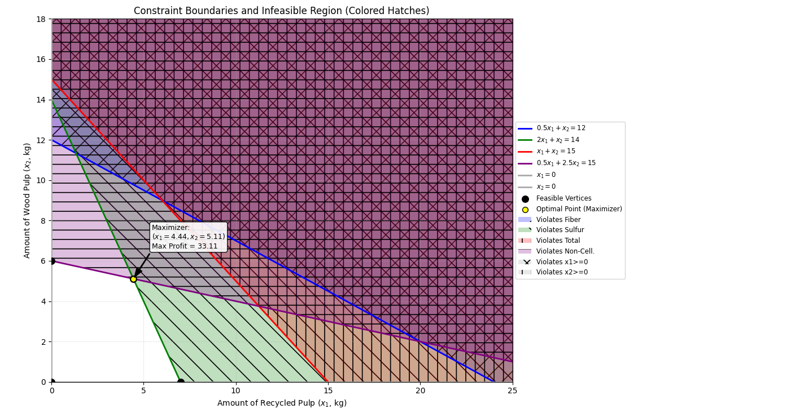
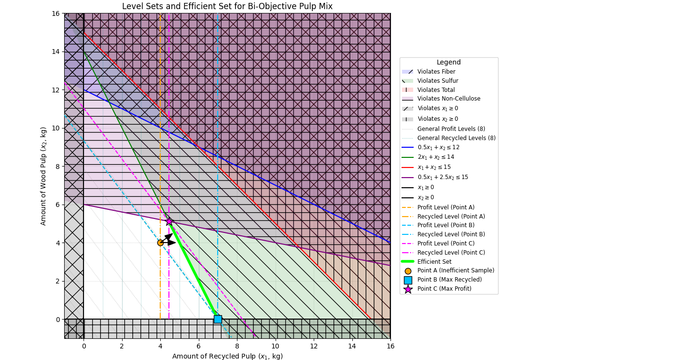
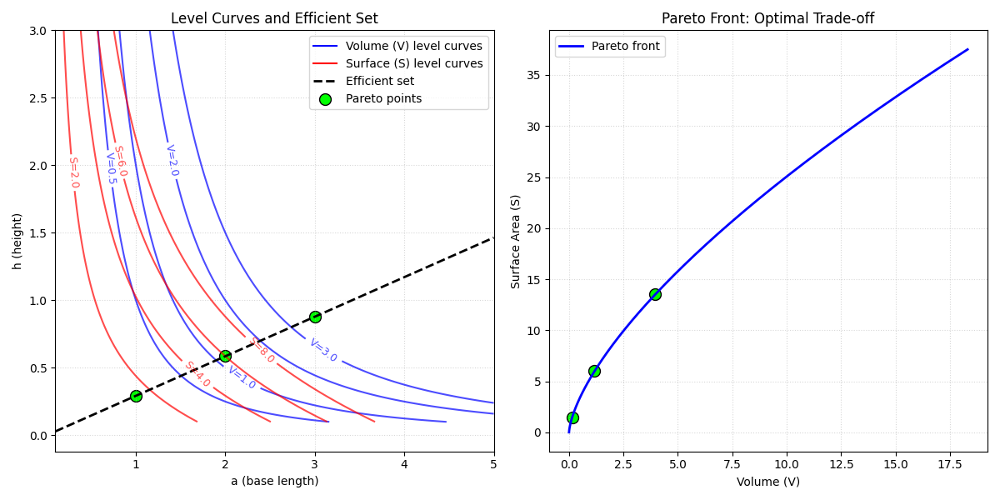
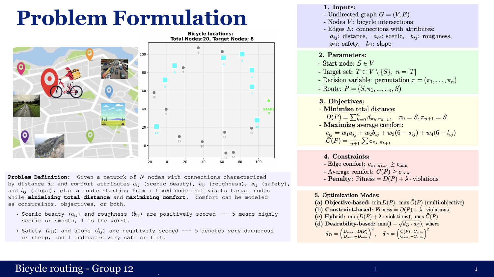
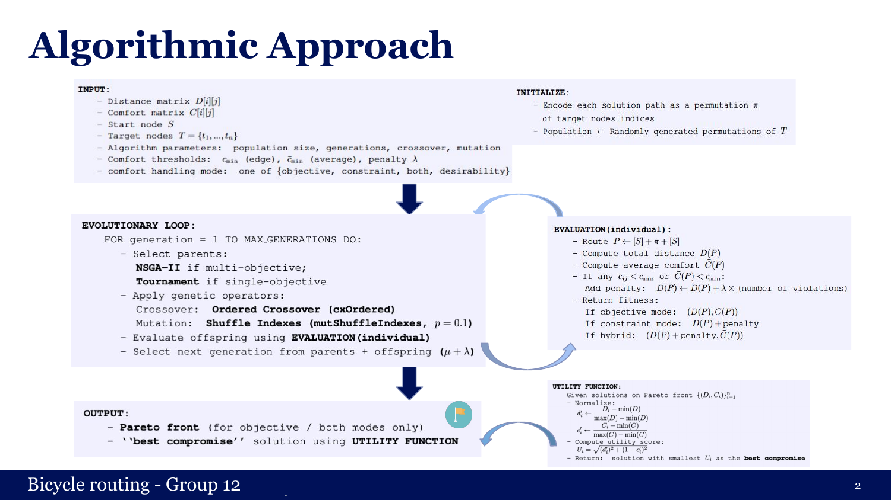
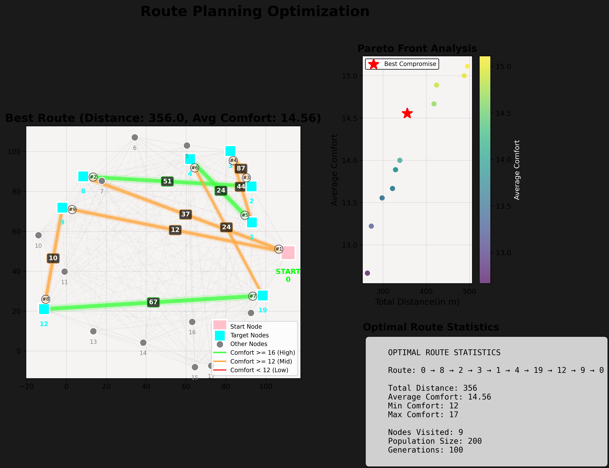
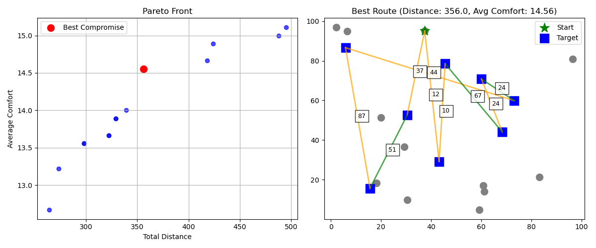
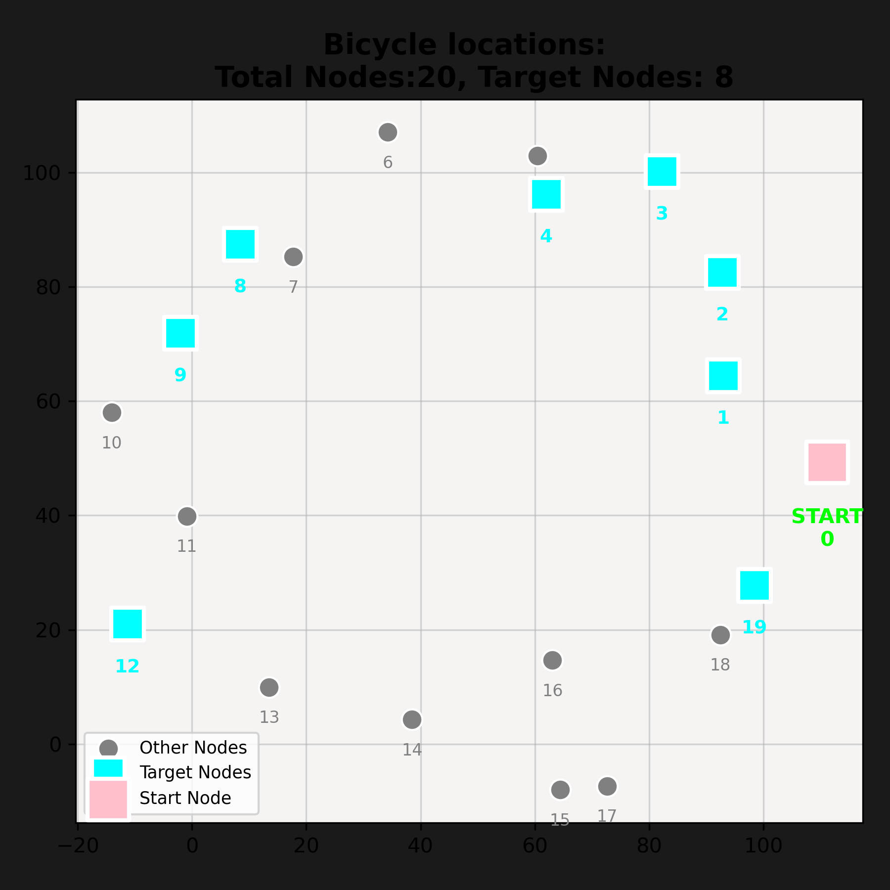
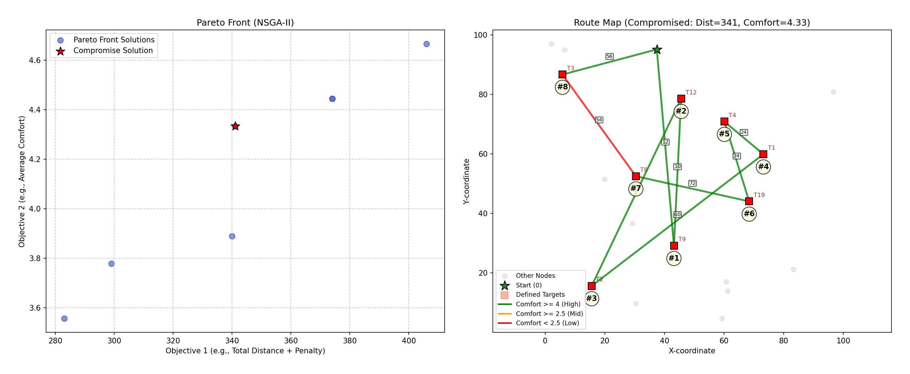
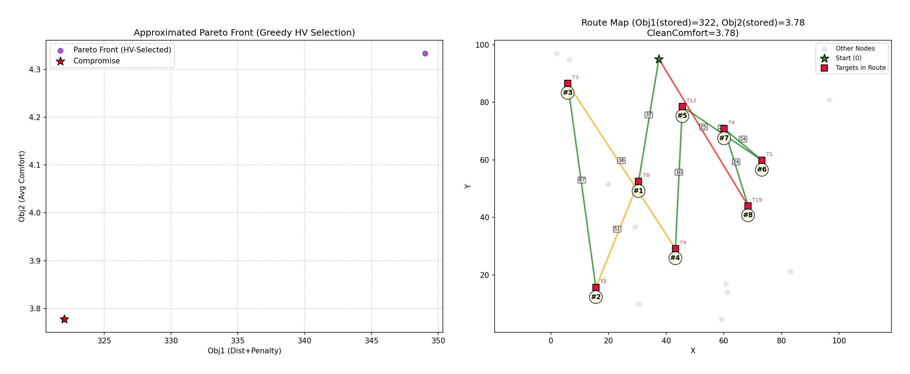

# Multicriteria Optimization & Decision Analysis

Two projects on multi-objective optimization in Python:

1. **[Pareto Analysis of Bi-Objective Problems](#1-pareto-analysis-of-bi-objective-problems):** linear programming, efficient sets, level-set analysis and analytical Pareto fronts.
2. **[Multi-Objective Bicycle Route Planning](#2-multi-objective-bicycle-route-planning):** an NSGA-II evolutionary algorithm that trades off route distance against riding comfort.

```
multicriteria-optimization/
├── pareto-analysis/          # LP solving, efficient sets, Pareto fronts
├── bicycle-route-planning/   # NSGA-II route planner (+ experiments/ with alternative selection strategies)
└── figures/                  # plots used in this README
```

---

## 1. Pareto Analysis of Bi-Objective Problems

*Author: Priyanjali Goel*

### Paper-pulp mixing (multi-objective LP)

A paper factory mixes recycled pulp (x₁), wood pulp (x₂) and pure cellulose fibre into a 15 kg charge.

```
maximize   4x₁ + 3x₂            (profit)
maximize   x₁                   (recycled pulp, second objective)
subject to 0.5x₁ +    x₂ ≤ 12   (short fibre)
             2x₁ +    x₂ ≤ 14   (sulfur)
              x₁ +    x₂ ≤ 15   (total weight)
           0.5x₁ + 2.5x₂ ≤ 15   (non-cellulose)
           x₁, x₂ ≥ 0
```

- **Single objective:** enumerating the feasible vertices (0,0), (0,6), (4.44, 5.11) and (7,0) gives a maximum profit of **33.11 at (4.44, 5.11)**. `pulp_mix_lp_solver.py` confirms this with PuLP.
- **Bi-objective:** the efficient set is the edge **B–C** between the recycling optimum (7, 0) and the profit optimum (4.44, 5.11). I verified this with the Level Set Theorem: along B–C the level sets of the two objectives meet only on their boundaries, while interior points such as A are dominated.

| Feasible region and profit maximizer | Level sets and efficient set |
|---|---|
|  |  |
| *Infeasible regions hatched per violated constraint; the optimum is at (4.44, 5.11).* | *Profit and recycling level sets through points A, B and C. The green segment B–C is the efficient set.* |

### Box design: surface area vs. volume

The second problem minimizes surface area S(a, h) = (2 + √2)·a·h + ½a² and maximizes volume V(a, h) = ½a²h.

- **Lagrange multipliers** (fixed volume V_ε): a\* = ∛(2(2+√2)V_ε), h\* = a\*/(2+√2).
- **ε-constraint method:** the efficient set is the ray **h = a / (2 + √2)**, and the Pareto front is **S(V) = (3/2)(4 + 2√2)^{2/3} V^{2/3}**.


*Left: level curves of V (blue) and S (red) with the efficient set (dashed) and the Pareto-optimal points P1–P3. Right: the resulting Pareto front in objective space.*

I also analysed the Pareto, weak componentwise, incomparability and indifference relations (transitivity, reflexivity, asymmetry, antisymmetry, symmetry). I formulated two Manhattan-disc packing problems as optimization models: maximizing the radius for *k* discs, and maximizing the number of discs using binary variables with a linearized non-overlap constraint.

### Scripts

| Script | Output |
|---|---|
| `pulp_mix_feasible_region.py` | Feasible region, vertices and profit maximizer |
| `pulp_mix_lp_solver.py` | LP solution with PuLP |
| `pulp_mix_efficient_set.py` | Level sets and the efficient set for both objectives |
| `box_design_pareto_front.py` | Level curves, efficient set and Pareto front |
| `box_design_dominated_region.py` | Dominated region relative to the Pareto front, with test points |

---

## 2. Multi-Objective Bicycle Route Planning

*Team project*

### Problem

Starting at a fixed node in a 20-node network of bicycle intersections, find a round trip that visits 8 target nodes and:

- **minimizes total distance** D(P), and
- **maximizes average comfort** C̄(P). Edge comfort combines scenic beauty, roughness, safety and slope: c = w₁a + w₂b + w₃(6 − s) + w₄(6 − l).

The route can be subject to comfort constraints: a minimum comfort per edge, a minimum average comfort, and a penalty λ for each violation.



### Approach

Each solution is a **permutation of the target nodes**, evolved with DEAP:

- **Selection:** NSGA-II for the multi-objective modes, tournament selection for the single-objective modes.
- **Variation:** ordered crossover and shuffle-index mutation (p = 0.1), with (μ + λ) survivor selection.
- **Comfort-handling modes:**
  - *objective*: the bi-objective min D, max C̄.
  - *constraint*: D + λ·violations.
  - *hybrid* (`both`): constraint penalties combined with the bi-objective search.
  - *desirability*: a single scalar 1 − √(d_D · d_C).
- **Best compromise:** after the run, a utility function picks the Pareto solution closest to the ideal point.



### Results (hybrid mode)

Parameters: population 200, 100 generations, crossover 0.7, mutation 0.2, minimum average comfort 12, minimum edge comfort 8, λ = 10,000.

- **Best compromise route:** 0 → 8 → 2 → 3 → 1 → 4 → 19 → 12 → 9 → 0
- **Distance:** 356, **average comfort:** 14.56 (edge comfort 12–17)


*The best route coloured by edge comfort, the Pareto front of distance vs. comfort with the best compromise starred, and summary statistics.*

| Pareto front and best route | Network: start and target nodes |
|---|---|
|  |  |

#### Selection strategy experiments

| NSGA-II with crowding distance | Greedy hypervolume selection |
|---|---|
|  |  |

### Takeaways

- The comfort-handling mode strongly shapes behaviour:
  - *Constraint* mode enforces comfort thresholds and yields the shortest feasible route.
  - *Desirability* mode merges distance and comfort into one balanced score.
  - *Hybrid* mode behaves like the objective mode once the constraints are met.
- Objective-based approaches keep the whole trade-off curve, so the decision can be made afterwards. Scalarizations are simpler but hide each objective's individual impact.

### Scripts

| Script | Description |
|---|---|
| `bicycle_route_nsga2.py` | Main planner: NSGA-II with all comfort modes; produces the dashboard and network plots |
| `bicycle_route_nsga2_basic.py` | Leaner version: Pareto front and best-route plot |
| `experiments/nsga2_crowding_distance.py` | NSGA-II variant with crowding-distance analysis |
| `experiments/hypervolume_greedy_selection.py` | Greedy hypervolume-based environmental selection (uses `pygmo`) |
| `experiments/nsga2_interactive_plots.py` | Interactive Plotly / seaborn visualisations |
| `experiments/bicycle_route_nsga2_robust.py` | Variant with more defensive evaluation and (μ + 2μ) offspring |

Set `Config.COMFORT_HANDLING` in a script to `'objective'`, `'constraint'`, `'both'` or `'desirability'` to switch modes.

---

## Setup

```bash
python -m venv .venv && source .venv/bin/activate
pip install -r requirements.txt

cd pareto-analysis && python pulp_mix_efficient_set.py
cd ../bicycle-route-planning && python bicycle_route_nsga2.py
```
